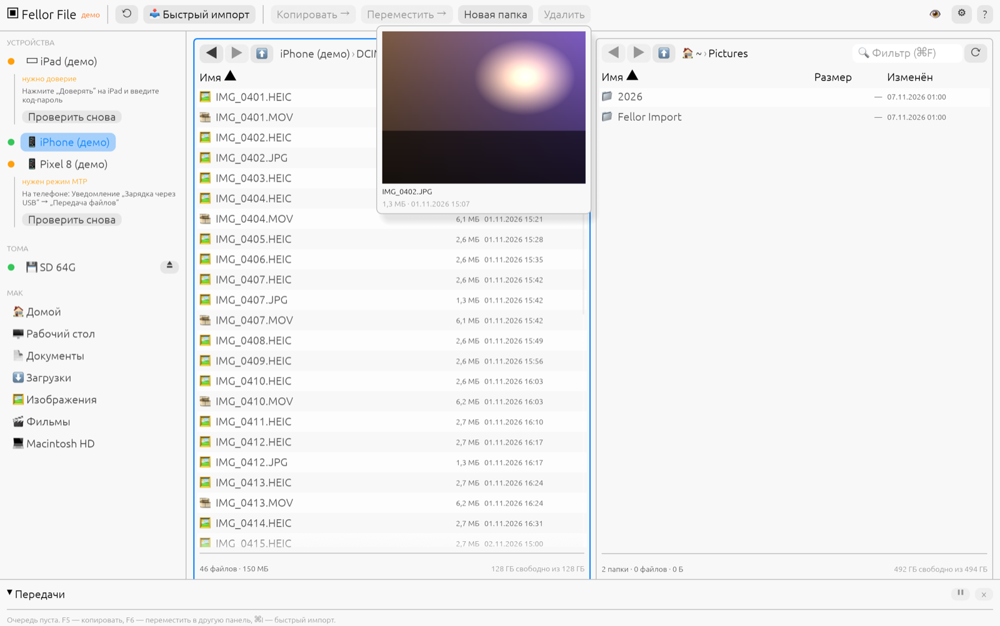

# Fellor File

**Файловый менеджер для macOS: перекидывайте файлы с iPhone, iPad, Android, фотоаппаратов и флешек на Mac и обратно — по кабелю, без iTunes, Finder-синхронизации и Android File Transfer.**

Написан на Rust с нуля: протоколы iPhone (usbmuxd, lockdown, AFC) и Android (MTP/PTP) реализованы в самом проекте, без libimobiledevice и libmtp.

[](LICENSE)




## Скачать

Последняя версия — на странице **[Releases](https://github.com/shzFas/fellor_file/releases/latest)**:

| Файл | Что это |
|---|---|
| `Fellor-…-macos-universal.dmg` | Приложение. Откройте и перетащите **Fellor** в «Программы». |
| `Fellor-…-macos-universal.zip` | То же приложение в ZIP. |
| `fellor-cli-…-macos-universal.tar.gz` | Консольная утилита `fellor` для скриптов. |
| `SHA256SUMS.txt` | Контрольные суммы. |

Одна сборка работает и на Apple Silicon (M1–M4), и на Intel. Нужна macOS 13 Ventura или новее.

### Первый запуск

Приложение не подписано платным сертификатом Apple Developer, поэтому при первом запуске macOS предупредит, что не может проверить разработчика. Это ожидаемо для бесплатных open-source программ. Чтобы открыть:

1. Откройте **Системные настройки → Конфиденциальность и безопасность**.
2. Внизу у сообщения про Fellor нажмите **«Всё равно открыть»** и подтвердите.

Или одной командой в Терминале:

```sh
xattr -dr com.apple.quarantine /Applications/Fellor.app
```

## Что умеет

- **iPhone и iPad** — фото и видео (DCIM), папка Downloads и документы приложений с общим доступом к файлам (VLC, Documents и др.).
- **Android** — вся внутренняя память и SD-карта в режиме «Передача файлов».
- **Фотоаппараты** по PTP, **флешки, SD-карты, внешние диски** и любые тома в `/Volumes`.
- **Две панели** — копирование и перемещение в обе стороны (F5 / F6), переименование, новые папки, удаление.
- **Очередь передач** с прогрессом, скоростью, паузой, отменой, докачкой и ожиданием, если кабель выдернули.
- **Конфликты имён** — пропустить, заменить, переименовать, оставить более новый, «применить ко всем».
- **Превью при наведении** — задержите мышь на файле: HEIC, JPEG, PNG, видео.
- **Большой просмотр** по пробелу с масштабом; **видео с телефона играет** в QuickTime по Enter.
- **Быстрый импорт** (⌘I) — забрать только новые фото и видео с телефона в папки по датам.
- Интерфейс на русском, светлая и тёмная темы.

### Подключение телефона

- **iPhone / iPad:** разблокируйте телефон, подключите кабель и нажмите **«Доверять этому компьютеру»**.
- **Android:** в шторке уведомлений нажмите «Зарядка через USB» → **«Передача файлов»**. Закройте Android File Transfer / OpenMTP, если они запущены.
- Если устройство не появляется, проверьте кабель (бывают кабели только для зарядки) и выполните `fellor doctor`.

### Горячие клавиши

| Клавиша | Действие |
|---|---|
| Tab | Переключить панель |
| F5 / F6 | Копировать / переместить в другую панель |
| F7 | Новая папка |
| F2 | Переименовать |
| F8 или ⌘⌫ | Удалить |
| Enter | Открыть папку / открыть файл (видео — в QuickTime) |
| Пробел | Большой просмотр |
| ⌘I | Быстрый импорт |
| ⌘F | Фильтр |
| ⌘, | Настройки |

## Консольная утилита

```sh
fellor devices                                  # подключённые устройства
fellor ls ios:/Media/DCIM                       # список файлов на iPhone
fellor cp ios:/Media/DCIM ~/Pictures/iPhone     # скопировать с iPhone
fellor cp ~/movie.mp4 "mtp:/Internal shared storage/Movies"
fellor import --device ios --dest ~/Pictures/Import
fellor doctor                                   # диагностика подключения
```

## Сборка из исходников

```sh
curl https://sh.rustup.rs -sSf | sh             # Rust, если ещё не установлен
git clone https://github.com/shzFas/fellor_file.git && cd fellor_file
cargo run --release -p fellor-app               # запустить GUI
cargo run --release -p fellor-app -- --demo     # GUI с демо-устройствами, без телефона
cargo test --workspace                          # тесты
./scripts/bundle.sh --universal                 # собрать .app, .dmg и .zip в dist/
```

Новый релиз собирается автоматически: создайте тег `vX.Y.Z` и отправьте его на GitHub — GitHub Actions соберёт и приложит файлы к релизу.

## Устройство проекта

| Крейт | Назначение |
|---|---|
| `fellor-vfs` | Общий контракт: `Backend`, `VPath`, ошибки |
| `fellor-local` | Локальная файловая система и тома |
| `fellor-usbmux`, `fellor-lockdown`, `fellor-afc`, `fellor-ios` | iPhone/iPad: usbmuxd → lockdown (TLS) → AFC / house_arrest |
| `fellor-ptp`, `fellor-mtp` | Android и камеры: PTP/MTP поверх USB |
| `fellor-transfer` | Очередь передач, конфликты, докачка |
| `fellor-index` | Индекс быстрого импорта (SQLite) |
| `fellor-devices` | Обнаружение устройств |
| `fellor-cli` | Консольная утилита `fellor` |
| `apps/fellor-app` | Графическое приложение (egui) |

Подробная техническая спецификация — в [SPEC.md](SPEC.md).

## Ограничения

- Доступ к iPhone ограничен тем, что Apple открывает без джейлбрейка: медиатека (DCIM и др.) и документы приложений с общим доступом к файлам.
- Фото, хранящиеся только в iCloud («Оптимизация хранилища»), физически не лежат на телефоне и не видны.
- Проект молодой: если что-то не работает с вашим устройством, откройте [issue](https://github.com/shzFas/fellor_file/issues) и приложите вывод `fellor doctor`.

## Лицензия

**MIT** — это свободное программное обеспечение с открытым исходным кодом. Вы можете **делать с проектом что угодно**: использовать, копировать, изменять, объединять с другим кодом, публиковать, распространять, сублицензировать и продавать — в том числе в коммерческих и закрытых продуктах. Единственное условие — сохранить текст лицензии и уведомление об авторских правах в копиях. Программа предоставляется «как есть», без гарантий.

Полный текст — в файле [LICENSE](LICENSE).

---

## English

**Fellor File** is an open-source macOS file manager written in Rust for moving files between a Mac and iPhone/iPad, Android phones, PTP cameras and mounted volumes over USB — no iTunes, no Android File Transfer. iOS (usbmuxd/lockdown/AFC) and Android (MTP/PTP) protocols are implemented from scratch in this repository.

Download the universal (Apple Silicon + Intel) `.dmg` from [Releases](https://github.com/shzFas/fellor_file/releases/latest). The app is ad-hoc signed, so on first launch allow it in *System Settings → Privacy & Security → Open Anyway*, or run `xattr -dr com.apple.quarantine /Applications/Fellor.app`.

Licensed under the [MIT License](LICENSE): you may use, copy, modify, merge, publish, distribute, sublicense and sell it for any purpose, as long as the license notice is kept.
